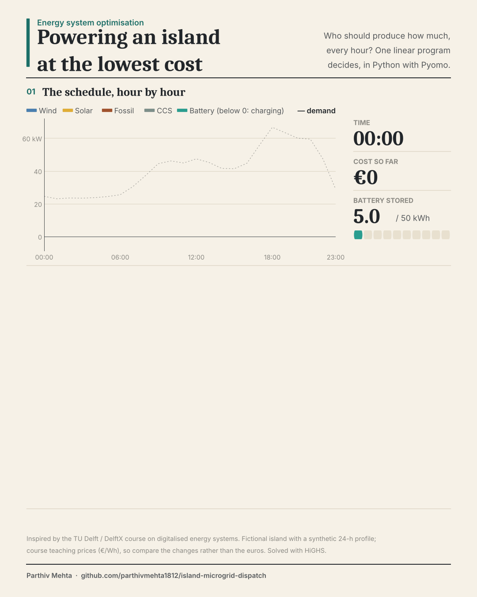
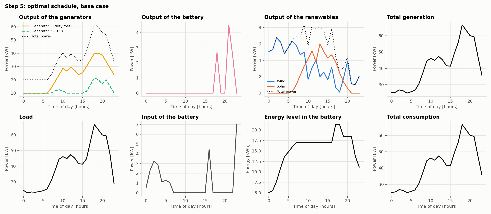
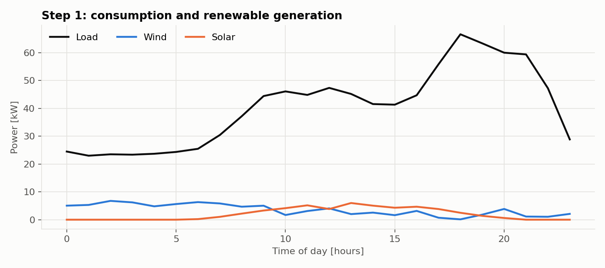
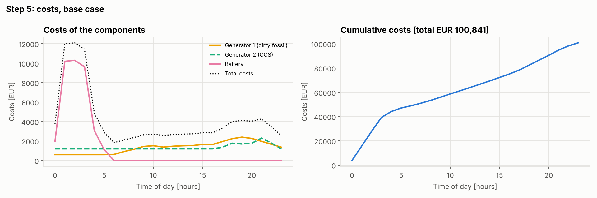
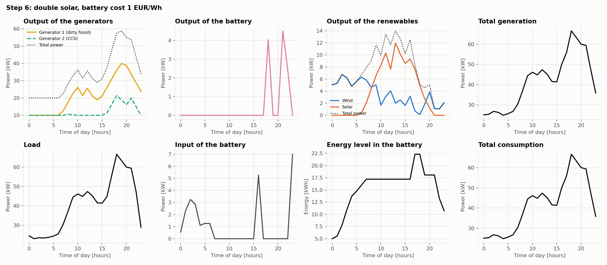
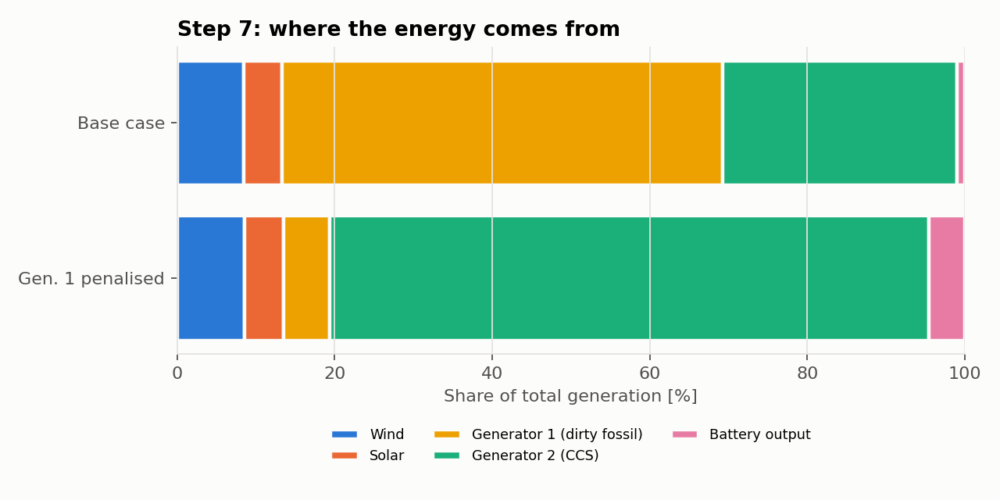
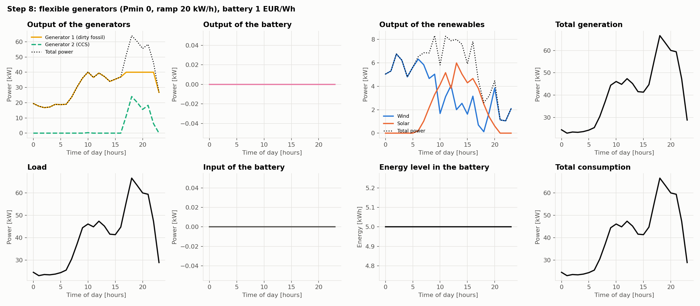

# Optimal Scheduling of an Island Energy System (Python, Pyomo)

How much should each unit of a small island energy system produce every hour, so that demand
is always met at the lowest cost? This project answers that with an optimisation model and
then tests how the schedule changes when costs, limits and renewable output change.

It follows the eight steps of the optimal-scheduling exercise in the TU Delft / DelftX course
*Digitalization of Intelligent and Integrated Energy Systems*. I wrote all the code myself
and ran it on my own 24-hour island profile.





---

## The system

| Unit | Parameters (course teaching values) |
|---|---|
| Generator 1 (dirty fossil) | €0.06/Wh, 10–40 kW, max. change 5 kW/h |
| Generator 2 (CCS) | €0.12/Wh, 10–40 kW, max. change 5 kW/h |
| Battery | €3.4/Wh charged or discharged, charge ≤ 7 kW, discharge ≤ 10 kW, 5–50 kWh, efficiency 96.78 % in / 94.78 % out |
| Wind | turbines up to 33.6 kW |
| Solar | small PV system, peak about 6 kW |

The costs are the course's teaching values in **€ per Wh**, so the totals are much higher than
real-world costs. They are kept on purpose, so the results can be compared with the course case.

**Model** (`island_dispatch.py`, Pyomo + HiGHS): minimise generator costs + battery costs, subject to
* power balance every hour: generators + wind + solar + battery output = load + battery input
* each generator stays between its minimum and maximum output and can change by at most 5 kW per hour
* battery energy: next level = current level + 0.9678 × input − output / 0.9478, kept between 5 and 50 kWh
* wind and solar are always used in full

---

## Step by step

### Step 1: Inspect the consumption and weather profile


The load is low at night (about 24 kW), rises in the morning, stays around 42–47 kW during the
day, and then jumps to a sharp **evening peak of 67 kW at 18 h**, when people come home. It drops
steeply late at night. Solar follows the sun and peaks around midday. Wind is low on this calm
day. Together, wind and solar supply only **14 % of the daily load** and are below the load in
every hour, so the generators and the battery are needed.

### Step 2: Build and solve the model
The model finds the cheapest schedule for all 24 hours at once.

### Step 3: Check the power balance and the limits
* Generation equals consumption in every hour (consumption includes battery charging).
* Generator 1 stays between 10 and 40 kW, and Generator 2 between 10 and 21 kW.
* Neither changes by more than 5 kW per hour.

### Step 4: Compare the costs of the generators
| | Energy | Cost |
|---|---:|---:|
| Generator 1 (€0.06/Wh) | 557 kWh | €33,420 |
| Generator 2 (€0.12/Wh) | 297 kWh | €35,640 |
| Battery (€3.4/Wh) | 23.8 kWh in, 9.6 kWh out | €113,822 |
| **Total** | | **€182,883** |

Generator 2 is twice as expensive per Wh, so the model uses it as little as possible. It runs at
its 10 kW minimum most of the day and only rises in the morning and evening, when Generator 1
is limited by its 5 kW/h ramp or its 40 kW maximum.

### Step 5: Plot the schedule and the costs


* **At night,** both generators must run at their 10 kW minimum, which is more than the load
  minus wind. The surplus has nowhere to go, so the battery is forced to charge.
* **Before and during the evening peak,** the load rises faster than the generators can ramp. The
  battery charges at 16 h and discharges at 18 h to fill the gap.
* **Late at night,** the load drops faster than the generators can ramp down. The battery first
  discharges (21–22 h) so that Generator 2 can come down, then absorbs the surplus at 23 h at its
  7 kW maximum.

Because every Wh in or out costs €3.4, the battery is the **largest cost of the day**, even
though it stores very little energy. Its level stays between 5 and 21 kWh of its 50 kWh capacity.

### Step 6: Double the solar generation and make the battery cheaper (€1/Wh)


The total cost falls by **44 %** (€182,883 → €101,605). Almost all of the saving comes from the
cheaper battery (€113,822 → €35,867). Doubling solar saves only about €3,300 on the generators,
because solar is small compared with the load and is gone in the evening, when demand is highest.

### Step 7: Renewable share, and dirty fossil below 10 %


In the base case, renewables supply **13 %** of generation and Generator 1 (dirty fossil) supplies
**56 %**. To push dirty fossil below 10 %, Generator 1 is penalised in two ways:

```python
gens7[0].cost = 4.0   # 0.06 -> 4 EUR/Wh: now the most expensive option, even above the battery
gens7[0].pmin = 0     # it no longer has to run at 10 kW all day, so it can switch off
```

Dirty fossil drops to **5.9 %**. Generator 2 takes over, and the battery discharges in the evening
peak. Generator 1 is still needed for a few evening hours, because Generator 2 can only ramp up
5 kW per hour. Raising the cost alone would not be enough, because the 10 kW minimum would still
force 240 kWh of dirty fossil energy per day. (The total cost in this step includes the €4/Wh
penalty, so it is not a real cost.)

### Step 8: Reduce the costs even more


Making both generators flexible (minimum 0 kW, ramp 20 kW/h) and the battery cheaper (€1/Wh)
cuts the total cost by **69 %** (€182,883 → €56,141). The cheap Generator 1 can now follow the load
on its own up to 40 kW. Generator 2 is only needed at the evening peak, and the battery is no
longer forced to absorb surplus or cover fast changes, so it is not used at all.

---

## Key takeaways
* Technical limits drive the schedule as much as prices do. The minimum output and ramp limits
  force the expensive generator to run and the battery to charge.
* The battery mainly covers what the generators cannot do: the forced night surplus and fast load changes.
  Its high cost per Wh made it the largest cost, even though it stored very little energy.
* Making generators more flexible saved more money than adding solar.
* Lowering dirty fossil generation needs both a higher price and the ability to switch the unit off.

---

## Run it yourself

```bash
git clone https://github.com/parthivmehta1812/island-microgrid-dispatch.git
cd island-microgrid-dispatch
python -m venv .venv
# Windows: .venv\Scripts\activate    macOS/Linux: source .venv/bin/activate
pip install -r requirements.txt
python island_dispatch.py      # prints Steps 1–8, saves plots to ./assets, data to ./results
```

```
island-microgrid-dispatch/
├── island_dispatch.py      # entry point: runs Steps 1–8
├── requirements.txt
├── src/island/             # source package
│   ├── data.py             # island profile, Generator & Battery dataclasses
│   ├── model.py            # Pyomo optimisation model
│   └── plots.py            # all figures
├── assets/                 # plots committed to git (visible in this README)
├── data/                   # generated input CSV (git-ignored)
└── results/                # generated schedules, summary, report (git-ignored)
```

---

## Acknowledgements

The study design and the component values come from the optimal-scheduling exercise of the
TU Delft / DelftX course *Digitalization of Intelligent and Integrated Energy Systems*. The code
and the 24-hour island profile are my own. No course notebooks, helper code or data are included.

**Cross-check:** I also ran this model on the course's reference case. It reproduced the course's
reference results exactly: the same total cost and the same hour-by-hour generator and battery
schedule.

Author: Parthiv Mehta · [LinkedIn](https://www.linkedin.com/in/parthivmehta) · MIT License
